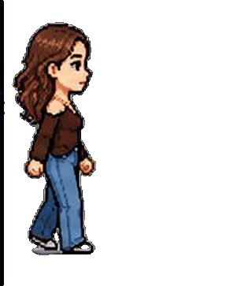

" />

 

## Who Am I?

Hi, I'm Ilaria and welcome to my GitHub profile!

I've a Bachelor's Degree in CS at the University of Ferrara and I'll study for a Master's Degree in CS at the University of Bologna.

I enjoy learning more every day about this world. I love details, perfection, and art.

 

## Tools

                           <!-- c -->
                       <!-- python -->
                  <!-- java -->
     <!-- js -->
                       <!-- php -->
                  <!-- html -->
                       <!-- css -->

                    <!-- mysql -->

             <!-- laravel -->

               <!-- ollama -->
  
                 <!-- canva -->
             <!-- drawio -->
  

 

## Some Projects 

Take a look at my projects! Watch my ideas come true!

**[RAG Assistant]** 
It was my BSc thesis project. A RAG assistant for the consultation of technical documents, with Knowledge Base and vector database Qdrant. This system is integrated in a chatbot to make the consultation easier for the user.
🔗 [Go to repo]<a href="https://github.com/ilariacnf9/technical-rag-system.git">

 

## Where you can find me

  
  

